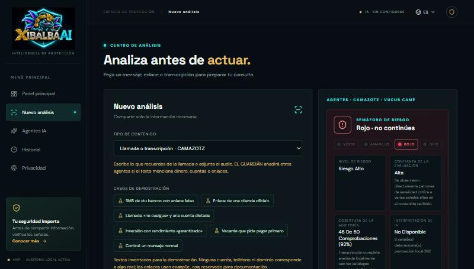
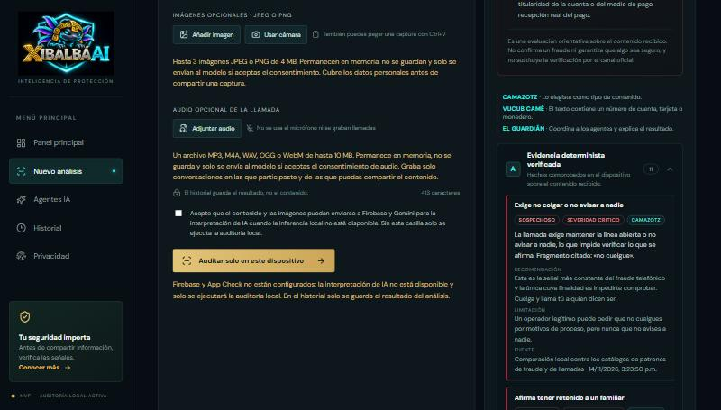

# Cómo evaluar XIBALBÁ

**Aplicación en línea: <https://xibalba-firebase-2026.vercel.app>**

No hace falta instalar nada, ni registrarse, ni dar ningún dato. Abre el enlace
y en dos minutos puedes recorrer todo lo que sigue. Funciona igual en teléfono y
en escritorio.

> **Lo primero que verás es una etiqueta: «IA · SIN CONFIGURAR».** Está puesta a
> propósito. La clave de App Check del proyecto de Firebase no está cargada en
> el despliegue, así que la interpretación de IA no se activa, y la aplicación
> lo dice en lugar de disimularlo. Todo lo que verás funcionando es la auditoría
> determinista, que se ejecuta entera en tu dispositivo. La sección 5 explica
> qué cambia cuando la IA sí está configurada.

## 1. Recorrido de dos minutos

1. Pulsa **Iniciar análisis**.
2. En **Casos de demostración**, elige **«Llamada: "no cuelgue" y una cuenta
   dictada»**. El tipo de contenido cambia solo a *Llamada o transcripción* y el
   texto se rellena.
3. Pulsa **Auditar solo en este dispositivo**.

Verás esto, y conviene mirarlo con calma:

| Qué | Dónde mirar |
|---|---|
| **Rojo · no continúes**, riesgo alto, confianza alta | Semáforo, arriba a la derecha |
| **8 señales deterministas, puntuación 362** | Bajo «Interpretación de IA» |
| **46 de 50 comprobaciones (92 %)** | Cobertura de la auditoría |
| **Qué NO se comprobó** | «Comprobaciones pendientes»: identidad de quien llamó, titularidad de la cuenta, recepción del pago |
| **Qué agentes intervinieron y por qué** | CAMAZOTZ (lo elegiste), VUCUB CAMÉ (el texto trae una cuenta), EL GUARDIÁN (coordina) |

4. Baja a la lista de evidencias. Cada una trae **el fragmento citado**, su
   severidad, el agente que la aportó, una recomendación y —esto es lo
   importante— **su limitación**: lo que esa señal no puede demostrar.

5. Busca la evidencia **«La cuenta no pertenece al banco que nombra el
   mensaje»**. La llamada dice *Santander*; la CLABE dictada empieza por 127,
   que corresponde a **Banco Azteca**. Esa contradicción se calcula en el
   dispositivo con el dígito verificador de la CLABE, sin consultar a nadie.

6. Fíjate en que la CLABE aparece **enmascarada** (`127***********0006`) en toda
   la evidencia. Completa solo está donde tú la escribiste.

## 2. La prueba que más dice: el control negativo

Vuelve a **Casos de demostración** y elige **«Control: un mensaje normal»**.
Audita.

Resultado: **Gris · información insuficiente**.

No es un fallo. Es la regla central del proyecto: **el verde no se regala**. Sin
señales y sin interpretación de IA, la herramienta dice que no tiene base para
opinar, en lugar de pintar de verde un mensaje que no analizó a fondo. Una
herramienta que dice «seguro» a la ligera es peor que ninguna.

Los otros cuatro casos —SMS de banco, enlace de tienda, inversión garantizada y
vacante falsa— cubren los demás agentes.

## 3. Privacidad, comprobable sin creernos nada

| Afirmación | Cómo comprobarla aquí mismo |
|---|---|
| El contenido no se envía sin tu permiso | La casilla de consentimiento está **desmarcada**. Sin marcarla, el único botón es «Auditar solo en este dispositivo» |
| No se guarda nada sin permiso | Abre las herramientas del navegador → Application → Local Storage. Está **vacío** |
| El historial guarda el resultado, no el contenido | Ve a **Historial**, marca «Guardar el historial en este navegador» y vuelve a mirar Local Storage: verás semáforo, nivel, señales y un fragmento con **todo número de cuatro o más dígitos enmascarado**. Ningún número de cuenta |
| Desmarcar borra | Desmarca la casilla: las claves desaparecen |
| No se visita el enlace analizado | Prueba el caso del enlace: el dominio es `example.com`, reservado para documentación. La red no registra ninguna petición a él |

## 4. Seguridad, si quieres mirar debajo

```bash
curl -I https://xibalba-firebase-2026.vercel.app
```

Devuelve `Content-Security-Policy`, `Strict-Transport-Security`,
`X-Frame-Options: DENY`, `Referrer-Policy: no-referrer`,
`Cross-Origin-Opener-Policy: same-origin`, `X-Content-Type-Options: nosniff` y
`Permissions-Policy: camera=(self), microphone=(), geolocation=()…`.

Dos endpoints, y sus respuestas reales en este despliegue:

| Petición | Respuesta | Por qué |
|---|---|---|
| `POST /api/app-check-debug` | **404** | El endpoint de depuración no existe fuera de desarrollo |
| `POST /api/audit/external` desde fuera | **403** | Capa anti-CSRF: exige `sec-fetch-site: same-origin`, que solo pone el navegador |
| `POST /api/audit/external` desde la propia página | **503** | El servidor no tiene configurado el número de proyecto, así que **no puede verificar** el token de App Check… y por eso lo rechaza. No acepta tokens sin verificar |

Ese 503 es el comportamiento que más vale la pena señalar: ante una
configuración incompleta, el endpoint **falla cerrado**. En ningún momento se
desactivó App Check para que algo pareciera funcionar.

## 5. Qué cambia cuando la IA está configurada

> Esto no es una promesa: está **comprobado** en local contra el proyecto de
> Firebase real. El caso de control pasó de gris a **verde**, el de la llamada
> siguió en **rojo** con sus 8 señales, y la etiqueta superior pasó a **«IA ·
> NUBE»**, indicando dónde se ejecutó la inferencia. Lo que falta para que
> ocurra en línea es una clave de App Check válida para el dominio desplegado.

Con la clave de App Check cargada, aparece un segundo botón que envía el
contenido a Gemini a través de Firebase AI Logic, en modo
`PREFER_ON_DEVICE`: intenta primero el modelo local del navegador y solo usa la
nube si no está disponible. La interfaz indica cuál de los dos respondió.

La regla que no cambia: **la IA solo puede subir el riesgo, nunca bajarlo**. Si
el motor determinista encontró ocho señales críticas, ninguna respuesta del
modelo puede convertir eso en verde. La IA aporta lectura e interpretación; el
veredicto se sostiene sobre evidencia comprobable.

Con IA, el caso de control pasa de **gris** a **verde**: es el único camino por
el que algo puede declararse sin señales.

## 6. Lo que XIBALBÁ no hace, dicho por nosotros

No intercepta llamadas. No abre el micrófono. No lee WhatsApp, SMS ni redes
sociales. No visita los enlaces que le pegas. No consulta la titularidad de
ninguna cuenta ni bases de la CNBV o la CONDUSEF. **No confirma un fraude.**

Orienta con evidencia y dice qué no pudo comprobar. La verificación por el canal
oficial sigue siendo de la persona.

## 7. Código y verificación

- Repositorio: `dyann1984/XIBALBA-FIREBASE-2026`, rama `release/xibalba-2026`.
- **175 pruebas automatizadas**, en verde en Node 22.23.4 y en Node 24.22.2
  (GitHub Actions, `.github/workflows/ci.yml`).
- Para ejecutarlo en local: `npm ci`, `npm run dev`. Sin claves de Firebase
  funciona exactamente igual que el despliegue que acabas de ver.
- Arquitectura y límites de cada agente: [`architecture.md`](architecture.md) y
  [`fase5-agentes.md`](fase5-agentes.md).
- Qué está comprobado y qué no: [`informe-lanzamiento.md`](informe-lanzamiento.md).




